<div align="center">

# 🚪 Система управления защитной дверью

**Лабораторная работа №2 · «Программное обеспечение мехатронных и робототехнических систем»**

B&R Automation Studio 4.5.2 · ANSI C · ACOPOSinverter · конечные автоматы · функциональные блоки

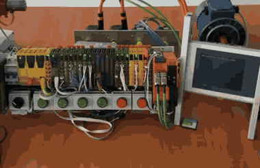

<sub>Стенд в режиме определения положения (ST_UNKNOWN): индикаторы мигают</sub>

</div>

---

## 📑 Содержание

1. [О проекте](#about)
2. [Задание](#task)
3. [Стенд и оборудование](#stand)
4. [Архитектура программы](#arch)
5. [Конечный автомат двери](#door-fsm)
6. [Конечный автомат преобразователя](#drive-fsm)
7. [Функциональные блоки и переменные](#blocks)
8. [Мэппинг](#mapping)
9. [Как повторить работу](#howto)
10. [Результаты эксперимента](#results)
11. [Мигание индикаторов: проверка по видео](#blink)
12. [Известные замечания](#notes)
13. [Исходный код](#code)
14. [Структура репозитория](#structure)

---

<a id="about"></a>

## 🎯 О проекте

Проект реализует программное обеспечение системы автоматического управления приводом защитной двери на учебном стенде. Логика построена на **конечных автоматах** и оформлена как три повторно используемых **функциональных блока** на языке ANSI C в среде **B&R Automation Studio 4.5.2.102**.

**Цель работы:** получить навыки построения программного обеспечения промышленных систем управления на базе функциональных блоков и конечных автоматов.

Что сделано:

- настроен частотный преобразователь ACOPOSinverter по паспортным данным асинхронного двигателя;
- регистры состояния и управления переведены из побитового представления в слова (packed);
- написаны три функциональных блока и программа Main, выполнен мэппинг на каналы датчиков, тумблера, индикаторов и преобразователя;
- проект загружен на контроллер и проверен в окне Watch (9 состояний двери);
- индикация сняла на видео, частота мигания измерена по кадрам.

<a id="task"></a>

## 📝 Задание

Дверь оснащена асинхронным двигателем с частотным преобразователем и четырьмя датчиками положения **S0–S3**, которые реагируют на пластину, закреплённую на двери. Открытие и закрытие задаётся тумблером направления (**0 = открыть, 1 = закрыть**).

- При включении дверь едет в заданную сторону **на малой скорости**, определяя своё положение. Индикаторы при этом мигают с частотой 1 Гц.
- В рабочем режиме на участке **S1–S2 максимальная скорость**, на участках S0–S1 и S2–S3 малая (безопасность движения).
- Индикаторы показывают положение двери.
- Система должна быть выполнена в виде функционального блока, допускающего повторное использование.

<div align="center">
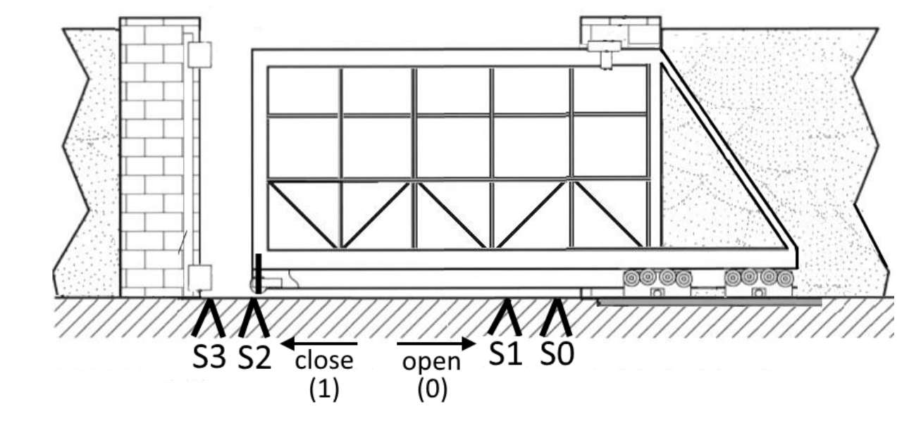

<sub>Устройство защитной двери: датчики S0 и S1 у открытого положения, S2 и S3 у закрытого</sub>
</div>

<a id="stand"></a>

## 🔧 Стенд и оборудование

<div align="center">
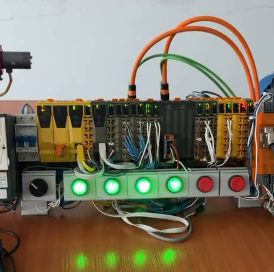
&nbsp;&nbsp;
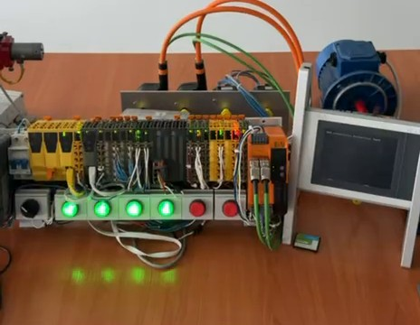
</div>

| Компонент | Назначение |
|---|---|
| Контроллер 4PP065_0571_P74 | исполнение программы Main, связь с Automation Studio |
| Модуль X20DI9371 | цифровые входы: тумблер направления и датчики S0–S3 |
| Модуль X20DO9322 | цифровые выходы: четыре светодиодных индикатора |
| ACOPOSinverter 8I64xxxxxxx.00x-1 | частотный преобразователь, управляется командным словом и заданием скорости |
| Асинхронный двигатель | привод двери |

Параметры двигателя в конфигурации преобразователя:

| Параметр | Название в конфигурации | Значение |
|---|---|---|
| Номинальное напряжение, В | UNS Rated Motor volt | 220 |
| Номинальная частота | FRS Rated motor freq [0,1 Гц] | 500 (50 Гц) |
| Сопротивление статора | RSC Cold Stator resist [мОм] | 33000 (33 Ом) |
| Коэффициент мощности | COS Motor 1 Cosinus Phi [0,01] | 64 (0,64) |
| Номинальная скорость, об/мин | NSP Rated motor speed [rpm] | 890 |
| Номинальный ток | NCR Rated motor current [0,1 А] | 10 (1,0 А) |

Скорости двери: **малая 200 об/мин** (22,5 % от номинальной), **максимальная 850 об/мин** (95,5 % от номинальной). Знак скорости задаёт направление: при открытии положительный, при закрытии отрицательный.

<a id="arch"></a>

## 🧩 Архитектура программы

<div align="center">
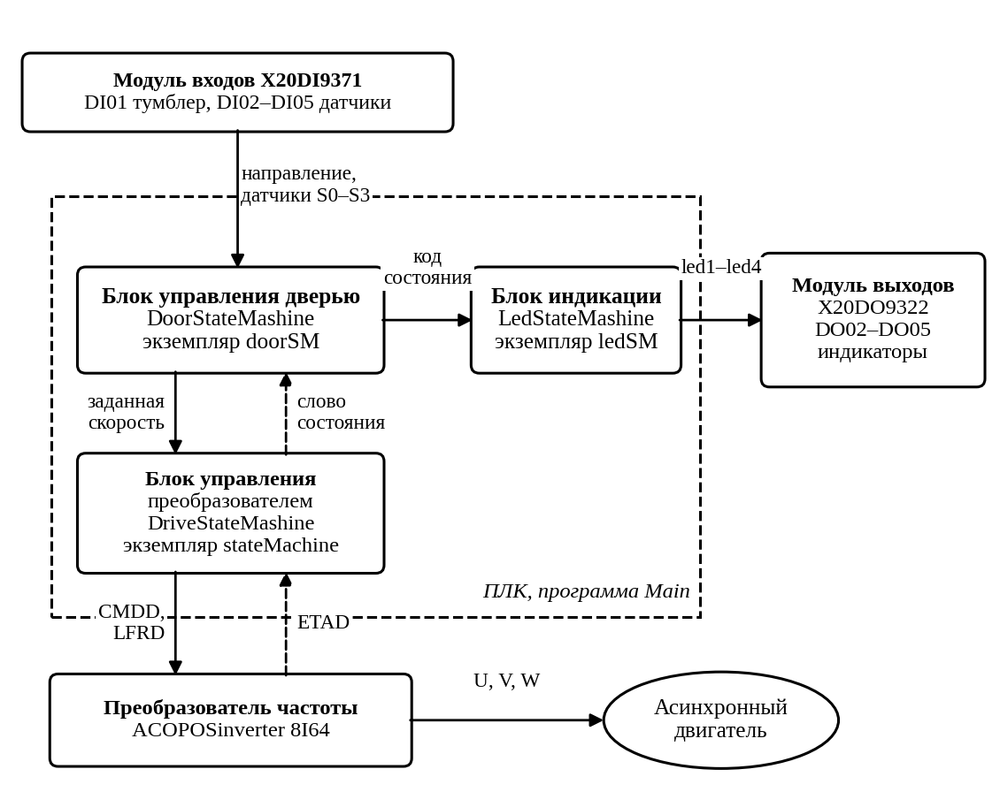
</div>

В циклической части программы Main блоки вызываются в таком порядке:

1. слово состояния преобразователя передаётся блоку двери;
2. блок двери по датчикам и направлению выбирает состояние и заданную скорость;
3. скорость передаётся блоку управления преобразователем, тот формирует команду и скорость для преобразователя;
4. код состояния двери передаётся блоку индикации.

<a id="door-fsm"></a>

## 🚦 Конечный автомат двери

<div align="center">
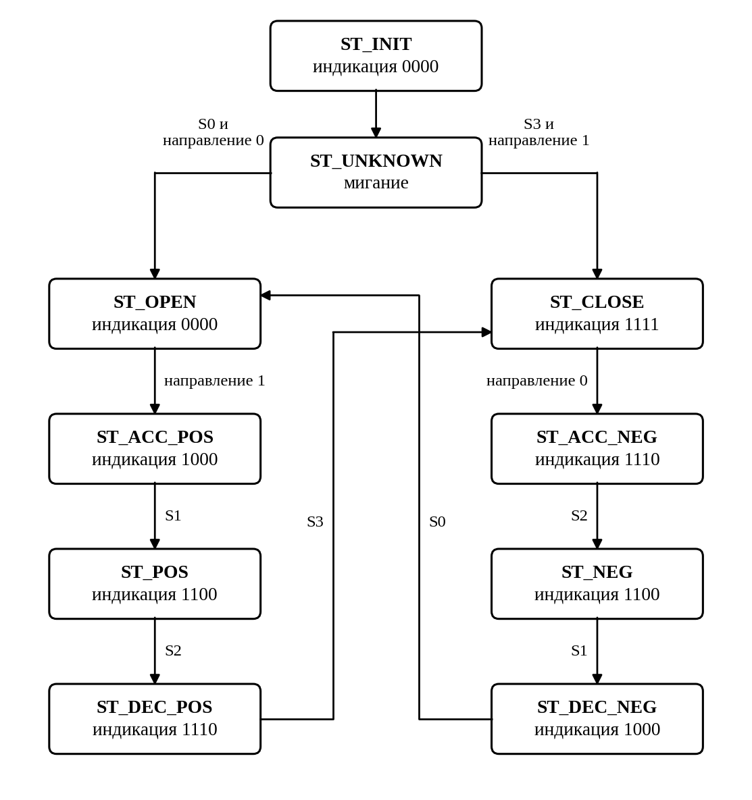

<sub>Основные переходы. Переходы при смене направления приведены в таблице ниже</sub>
</div>

### Состояния

| Состояние | Код | Индикация | Скорость, об/мин | Назначение |
|---|:-:|:-:|:-:|---|
| ST_INIT | 0 | 0000 | 0 | ожидание, пока преобразователь выйдет в рабочий режим |
| ST_UNKNOWN | 1 | мигание | 200 | поиск положения, движение с малой скоростью в сторону тумблера |
| ST_OPEN | 2 | 0000 | 0 | дверь открыта (датчик S0) |
| ST_CLOSE | 3 | 1111 | 0 | дверь закрыта (датчик S3) |
| ST_ACC_POS | 4 | 1000 | 200 | старт закрытия, участок S0–S1 |
| ST_ACC_NEG | 5 | 1110 | 200 | старт открытия, участок S3–S2 |
| ST_POS | 6 | 1100 | 850 | быстрое закрытие, участок S1–S2 |
| ST_NEG | 7 | 1100 | 850 | быстрое открытие, участок S2–S1 |
| ST_DEC_POS | 8 | 1110 | 200 | торможение перед закрытым положением, участок S2–S3 |
| ST_DEC_NEG | 9 | 1000 | 200 | торможение перед открытым положением, участок S1–S0 |

Индикация читается от первого светодиода к четвёртому, единица означает горящий светодиод. Чем ближе дверь к закрытому положению, тем больше светодиодов горит.

### Переходы

| Состояние | Условие | Следующее состояние |
|---|---|---|
| ST_INIT | преобразователь в рабочем состоянии | ST_UNKNOWN |
| ST_UNKNOWN | направление 0 и датчик S0 | ST_OPEN |
| ST_UNKNOWN | направление 1 и датчик S3 | ST_CLOSE |
| ST_OPEN | направление 1 | ST_ACC_POS |
| ST_ACC_POS | датчик S1 | ST_POS |
| ST_ACC_POS | направление 0 | ST_DEC_NEG |
| ST_POS | датчик S2 | ST_DEC_POS |
| ST_POS | направление 0 | ST_NEG |
| ST_DEC_POS | датчик S3 | ST_CLOSE |
| ST_DEC_POS | направление 0 | ST_ACC_NEG |
| ST_CLOSE | направление 0 | ST_ACC_NEG |
| ST_ACC_NEG | датчик S2 | ST_NEG |
| ST_ACC_NEG | направление 1 | ST_DEC_POS |
| ST_NEG | датчик S1 | ST_DEC_NEG |
| ST_NEG | направление 1 | ST_POS |
| ST_DEC_NEG | датчик S0 | ST_OPEN |
| ST_DEC_NEG | направление 1 | ST_ACC_POS |

Проверка смены направления стоит в коде раньше проверки датчиков. Если преобразователь выходит из рабочего состояния, автомат возвращается в ST_INIT.

> **Почему POS и NEG:** окончания в названиях обозначают цепочки движения. POS это движение от датчика S0 к S3 (закрытие), NEG от S3 к S0 (открытие). Схема из методички ниже подписана иначе, подробности в разделе [Известные замечания](#notes).

<details>
<summary>Схема состояний из методички (для сравнения)</summary>

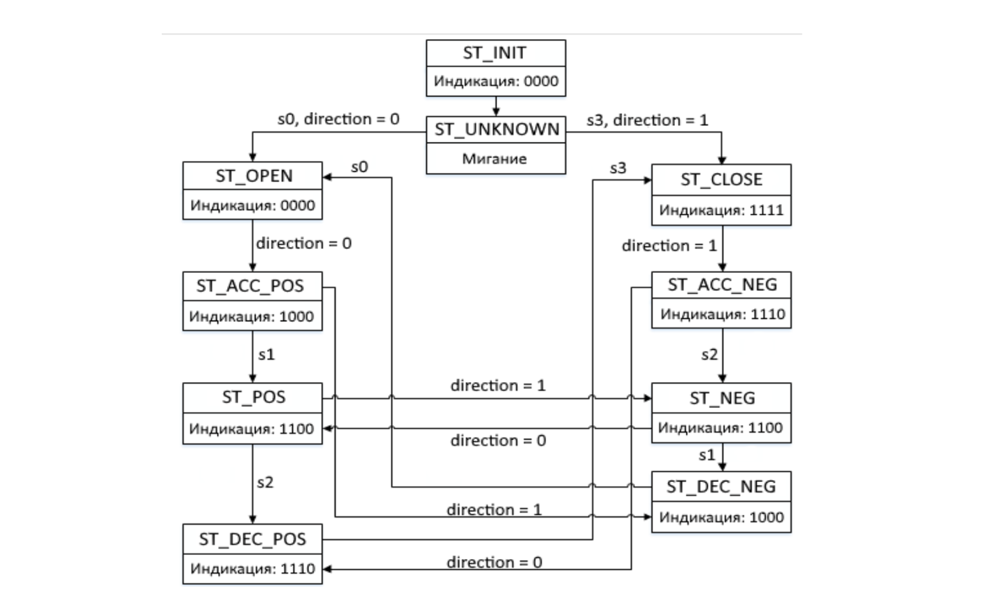

</details>

<a id="drive-fsm"></a>

## ⚙️ Конечный автомат преобразователя

<div align="center">
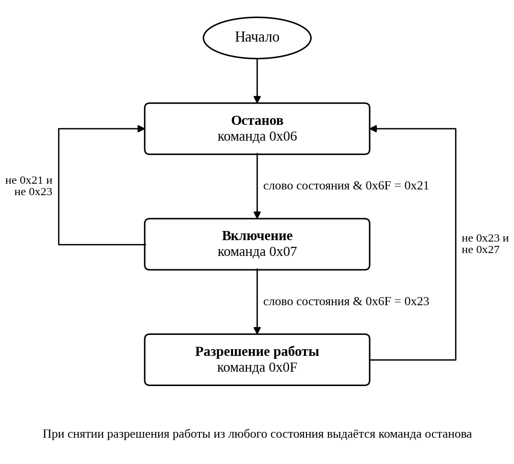
</div>

| Шаг | Команда | Ожидаемое слово состояния (после маски 0x6F) |
|---|---|---|
| Останов | 0x06 | 0x21, затем переход к включению |
| Включение | 0x07 | 0x23, затем переход к разрешению работы |
| Разрешение работы | 0x0F | 0x27, преобразователь выполняет заданную скорость |

При снятии разрешения работы из любого шага выдаётся команда останова. Экспериментально подтверждены команда 15 (0x0F) и значение 0x27 после маски; остальные коды приняты по стандартному профилю управления приводом.

<details>
<summary>Блок-схема из методички (для сравнения)</summary>

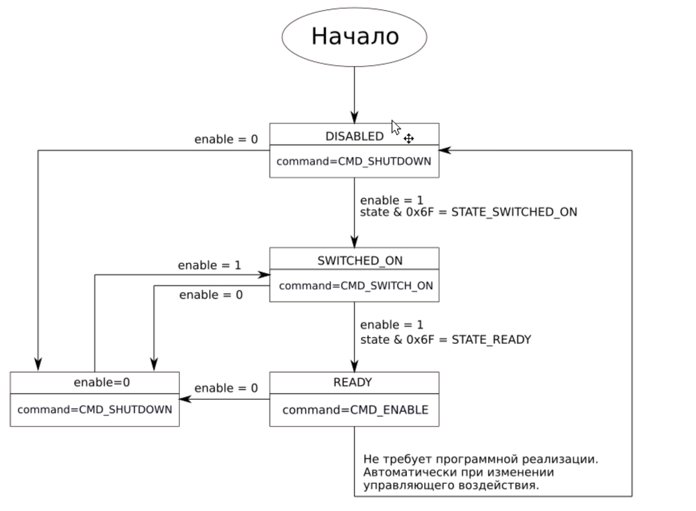

</details>

<a id="blocks"></a>

## 📦 Функциональные блоки и переменные

Блоки лежат в библиотеке **Library**, программа называется **Main**.

<div align="center">
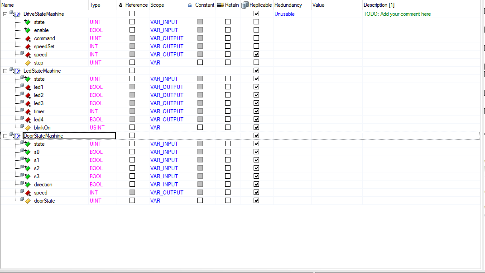

<sub>Объявление функциональных блоков в библиотеке</sub>
</div>

**DriveStateMashine**: управление частотным преобразователем

| Конфигурация | Имя | Тип | Описание |
|---|---|---|---|
| вход | state | UINT | слово состояния преобразователя |
| вход | enable | BOOL | разрешение работы блока |
| выход | command | UINT | команда управления преобразователем |
| выход | speedSet | INT | заданная скорость на преобразователь, об/мин |
| выход | speed | INT | скорость, формируемая блоком с учётом состояния преобразователя |
| внутренняя | step | UINT | служебная переменная шага автомата |

**LedStateMashine**: светодиодная индикация

| Конфигурация | Имя | Тип | Описание |
|---|---|---|---|
| вход | state | UINT | код состояния двери |
| выход | led1, led2, led3, led4 | BOOL | индикаторы |
| выход | timer | INT | счётчик циклов для отсчёта полупериода мигания |
| внутренняя | blinkOn | USINT | фаза мигания |

**DoorStateMashine**: логика двери

| Конфигурация | Имя | Тип | Описание |
|---|---|---|---|
| вход | state | UINT | слово состояния преобразователя |
| вход | s0, s1, s2, s3 | BOOL | датчики положения |
| вход | direction | BOOL | направление: 0 открыть, 1 закрыть |
| выход | speed | INT | заданная скорость, об/мин |
| внутренняя | doorState | UINT | код текущего состояния двери |

Экземпляры в программе Main:

<div align="center">
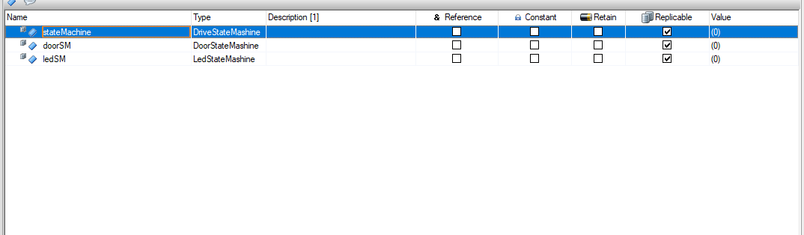
</div>

<a id="mapping"></a>

## 🔌 Мэппинг

| Модуль | Канал | Переменная |
|---|---|---|
| Преобразователь | ETAD_Input | `stateMachine.state` |
| Преобразователь | CMDD_Output | `stateMachine.command` |
| Преобразователь | LFRD_Output | `stateMachine.speedSet` |
| X20DI9371 | DigitalInput01 | `doorSM.direction` |
| X20DI9371 | DigitalInput02 | `doorSM.s0` |
| X20DI9371 | DigitalInput03 | `doorSM.s1` |
| X20DI9371 | DigitalInput04 | `doorSM.s2` |
| X20DI9371 | DigitalInput05 | `doorSM.s3` |
| X20DO9322 | DigitalOutput02 | `ledSM.led1` |
| X20DO9322 | DigitalOutput03 | `ledSM.led2` |
| X20DO9322 | DigitalOutput04 | `ledSM.led3` |
| X20DO9322 | DigitalOutput05 | `ledSM.led4` |

<a id="howto"></a>

## ▶️ Как повторить работу

1. Откройте проект в Automation Studio 4.5.2 и добавьте в Physical View модуль преобразователя 8I64xxxxxxx.00x-1, подключив его к шине.
2. В **Configuration** преобразователя задайте параметры двигателя из таблицы выше.
3. В ветке **I/O Mapping** конфигурации переключите ETAD, ETI, CMDD и CMI в режим **packed**.
4. Создайте программу Main (ANSI C Program) и библиотеку Library (ANSI C Library) с тремя функциональными блоками из папки [`src`](src). Переменные блоков берите из таблиц выше.
5. Объявите три экземпляра в `Variables.var` программы Main и выполните мэппинг по таблице.
6. Соберите проект, загрузите на контроллер (Transfer) и дождитесь режима RUN.
7. Откройте окно **Watch**, добавьте `stateMachine`, `doorSM`, `ledSM` и проверяйте состояния. Для получения нужного состояния выставляйте направление и датчики.

> ⚠️ При работе двигатель получает заданную скорость. Держите руку у аварийной остановки и убедитесь, что дверь может свободно двигаться.

<details>
<summary>Управление направлением кнопкой без фиксации (необязательно)</summary>

Если вместо тумблера используется кнопка, привяжите DigitalInput01 к отдельной переменной `btnDir` и добавьте защёлку в начало `Cyclic.c`:

```c
if (btnDir && !btnDirPrev) doorSM.direction = !doorSM.direction;
btnDirPrev = btnDir;
```

Обе переменные объявляются в `Variables.var` как BOOL. Это дополнение не входило в сданный вариант.
</details>

<a id="results"></a>

## 📊 Результаты эксперимента

Проверка выполнена в режиме онлайн в окне Watch. Состояния задавались записью кода в `doorState` при заданном направлении (см. таблицу), датчики оставались в нулевом состоянии. Полный цикл движения двери по датчикам в этих снимках не показан.

<div align="center">
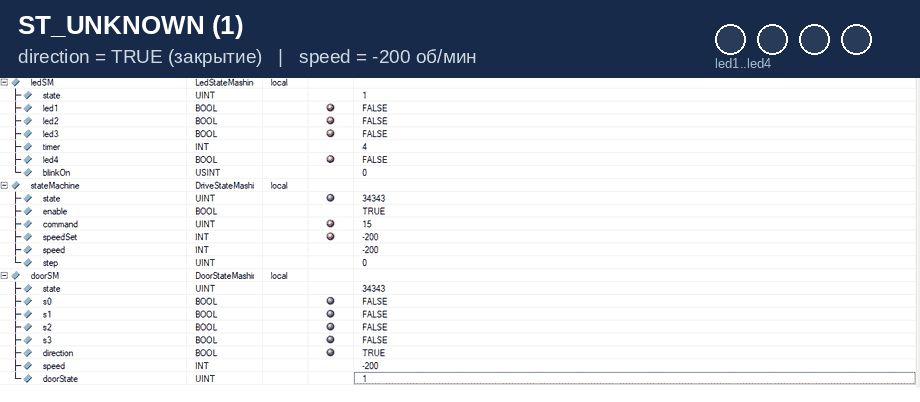

<sub>Все девять состояний, по порядку кодов</sub>
</div>

| № | Состояние (код) | Направление | Скорость, об/мин | Индикация | Слово состояния |
|:-:|---|:-:|:-:|:-:|:-:|
| 1 | ST_UNKNOWN (1) | 1 | -200 | 0000 (фаза выключения при мигании) | 34343 |
| 2 | ST_OPEN (2) | 0 | 0 | 0000 | 1575 |
| 3 | ST_CLOSE (3) | 1 | 0 | 1111 | 1575 |
| 4 | ST_ACC_POS (4) | 1 | -200 | 1000 | 34343 |
| 5 | ST_ACC_NEG (5) | 0 | 200 | 1110 | 1575 |
| 6 | ST_POS (6) | 1 | -850 | 1100 | 34343 |
| 7 | ST_NEG (7) | 0 | 850 | 1100 | 1575 |
| 8 | ST_DEC_POS (8) | 1 | -200 | 1110 | 34343 |
| 9 | ST_DEC_NEG (9) | 0 | 200 | 1000 | 1575 |

**Что видно по снимкам:**

- индикация и скорость во всех состояниях совпадают с таблицей состояний;
- преобразователь в рабочем режиме: команда 15 (0x0F), младший байт слова состояния 0x27;
- слово состояния равно 1575 (0x0627) при нулевой и положительной скорости и 34343 (0x8627) при отрицательной: меняется старший бит, который в конфигурации регистров преобразователя обозначает направление вращения;
- заданная скорость на преобразователе совпадает со скоростью блока двери, а код состояния в блоке индикации совпадает с кодом состояния двери.

<details>
<summary>Снимки Watch по состояниям</summary>

| | |
|---|---|
| **ST_UNKNOWN (1)**<br>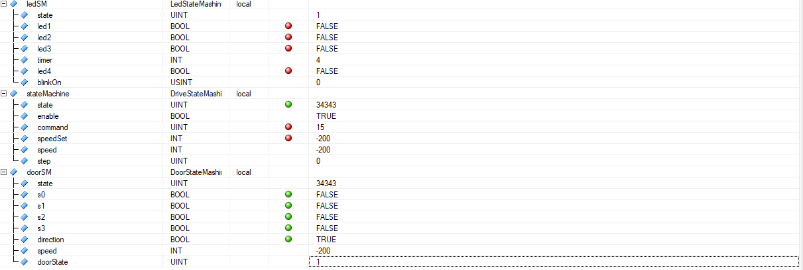 | **ST_OPEN (2)**<br>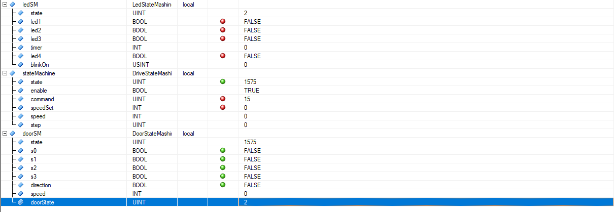 |
| **ST_CLOSE (3)**<br>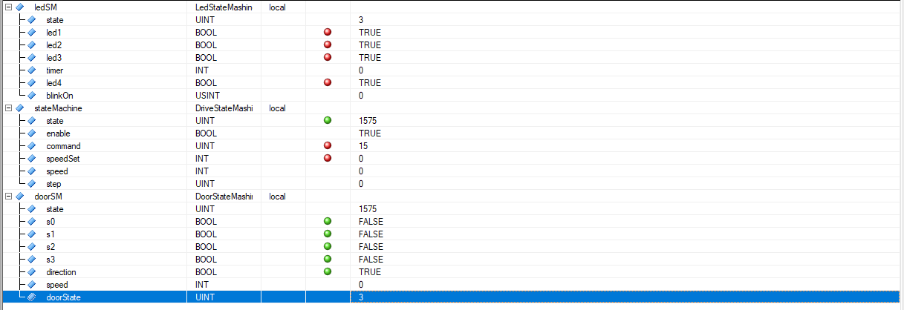 | **ST_ACC_POS (4)**<br>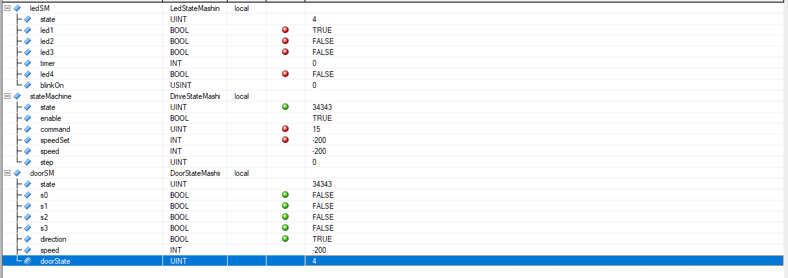 |
| **ST_ACC_NEG (5)**<br> | **ST_POS (6)**<br> |
| **ST_NEG (7)**<br> | **ST_DEC_POS (8)**<br> |
| **ST_DEC_NEG (9)**<br> | |

</details>

<a id="blink"></a>

## 🎥 Мигание индикаторов: проверка по видео

В режиме поиска положения индикаторы должны мигать с частотой 1 Гц. Видео со стенда снято со скоростью 30 кадров в секунду, и по нему можно измерить реальную частоту.

<div align="center">
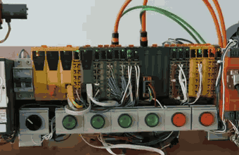
&nbsp;&nbsp;

</div>

| Видео | Переключений проверено | Интервал между переключениями | Полупериод | Период | Частота |
|---|:-:|:-:|:-:|:-:|:-:|
| крупный план | 63 | 3 кадра (все) | 0,1 с | 0,2 с | около 5 Гц |
| общий вид | 79 | 3 кадра (все) | 0,1 с | 0,2 с | около 5 Гц |

Индикаторы мигают примерно в пять раз быстрее заданного. Причина понятна по коду: полупериод считается как число циклов `500 / CYCLE_MS`, и при `CYCLE_MS = 10` это 50 циклов. Полупериод 0,1 с получается, когда реальное время цикла задачи около 2 мс. Исправление: задать в `CYCLE_MS` фактическое время цикла (посмотреть в свойствах класса задач в Software Configuration), тогда счётчик досчитает до 250 и мигание станет 1 Гц. В папке [`src`](src) уже стоит `CYCLE_MS = 2`; после загрузки стоит повторить видео и проверить период.

<a id="notes"></a>

## ⚠️ Известные замечания

1. **Частота мигания.** Измерена по видео, около 5 Гц вместо 1 Гц (см. раздел выше). Нужно подтвердить время цикла и поправить `CYCLE_MS`.
2. **Состояния задавались записью кода.** В снимках Watch датчики не двигались, состояния выставлялись записью `doorState`, а скорость, индикация и слово состояния считывались. Переходы по датчикам при реальном движении двери и реверс на ходу отдельно не сняты.
3. **ST_INIT не снимался.** Это начальное состояние держится только пока преобразователь не вышел в рабочий режим.
4. **Коды преобразователя.** По эксперименту подтверждены команда 0x0F и значение 0x27; 0x06, 0x07, 0x21 и 0x23 приняты по стандартному профилю управления приводом.
5. **Схема из методички.** На схеме состояний из методички переход из ST_OPEN в ST_ACC_POS подписан `direction = 0`, а в реализации и в таблице переходов он идёт при направлении 1 (рис. 2.6 методички: 1 означает закрытие, S3 у закрытого положения). Название состояний POS и NEG здесь следует индикации, а не описанию из табл. 2.3 методички.
6. **Скорости 200 и 850 об/мин** выбраны самостоятельно, в задании значения не заданы.

<a id="code"></a>

## 💻 Исходный код

Файлы лежат в папке [`src`](src). Для удобства ниже те же файлы в раскрывающихся блоках.

<details>
<summary><b>Cyclic.c</b> (программа Main)</summary>

```c
#include <bur/plctypes.h>
#ifdef _DEFAULT_INCLUDES
#include <AsDefault.h>
#endif

void _CYCLIC ProgramCyclic(void)
{
    stateMachine.enable = 1;

    doorSM.state = stateMachine.state;
    DoorStateMashine(&doorSM);

    stateMachine.speed = doorSM.speed;
    stateMachine.speedSet = doorSM.speed;
    DriveStateMashine(&stateMachine);

    ledSM.state = doorSM.doorState;
    LedStateMashine(&ledSM);
}
```
</details>

<details>
<summary><b>DriveStateMashine.c</b></summary>

```c
#include <bur/plctypes.h>
#ifdef _DEFAULT_INCLUDES
#include <AsDefault.h>
#endif

#define CMD_SHUTDOWN 0x0006
#define CMD_SWITCH_ON 0x0007
#define CMD_ENABLE 0x000F
#define STATE_MASK 0x006F
#define STATE_SWITCHED_ON 0x0021
#define STATE_READY 0x0023
#define STATE_OPERATION 0x0027

void DriveStateMashine(struct DriveStateMashine* inst)
{
    UINT st = inst->state & STATE_MASK;

    if (!inst->enable) {
        inst->command = CMD_SHUTDOWN;
        inst->speed = 0;
        return;
    }

    switch (inst->command) {

    case CMD_SWITCH_ON:
        inst->speed = 0;
        if (st == STATE_READY) inst->command = CMD_ENABLE;
        else if (st != STATE_SWITCHED_ON) inst->command = CMD_SHUTDOWN;
        break;

    case CMD_ENABLE:
        inst->speed = (st == STATE_OPERATION) ? inst->speedSet : 0;
        if (st != STATE_READY && st != STATE_OPERATION) inst->command = CMD_SHUTDOWN;
        break;

    default:
        inst->command = CMD_SHUTDOWN;
        inst->speed = 0;
        if (st == STATE_SWITCHED_ON) inst->command = CMD_SWITCH_ON;
        break;
    }
}
```
</details>

<details>
<summary><b>LedStateMashine.c</b></summary>

```c
#include <bur/plctypes.h>
#ifdef _DEFAULT_INCLUDES
#include <AsDefault.h>
#endif

#define ST_INIT 0
#define ST_UNKNOWN 1
#define ST_OPEN 2
#define ST_CLOSE 3
#define ST_ACC_POS 4
#define ST_ACC_NEG 5
#define ST_POS 6
#define ST_NEG 7
#define ST_DEC_POS 8
#define ST_DEC_NEG 9

/* CYCLE_MS must equal the task cycle time (Software Configuration, Cyclic class).
   Video measurement showed a 0.1 s half period with CYCLE_MS = 10, i.e. a real cycle of about 2 ms. */
#define CYCLE_MS 2
#define HALF_CYCLES (500 / CYCLE_MS)

void LedStateMashine(struct LedStateMashine* inst)
{
    if (inst->state == ST_UNKNOWN) {
        inst->timer++;
        if (inst->timer >= HALF_CYCLES) {
            inst->timer = 0;
            inst->blinkOn = !inst->blinkOn;
        }
    } else {
        inst->timer = 0;
        inst->blinkOn = 0;
    }

    switch (inst->state) {

    case ST_UNKNOWN:
        inst->led1 = inst->blinkOn; inst->led2 = inst->blinkOn;
        inst->led3 = inst->blinkOn; inst->led4 = inst->blinkOn;
        break;

    case ST_ACC_POS:
    case ST_DEC_NEG:
        inst->led1 = 1; inst->led2 = 0; inst->led3 = 0; inst->led4 = 0;
        break;

    case ST_POS:
    case ST_NEG:
        inst->led1 = 1; inst->led2 = 1; inst->led3 = 0; inst->led4 = 0;
        break;

    case ST_ACC_NEG:
    case ST_DEC_POS:
        inst->led1 = 1; inst->led2 = 1; inst->led3 = 1; inst->led4 = 0;
        break;

    case ST_CLOSE:
        inst->led1 = 1; inst->led2 = 1; inst->led3 = 1; inst->led4 = 1;
        break;

    default:
        inst->led1 = 0; inst->led2 = 0; inst->led3 = 0; inst->led4 = 0;
        break;
    }
}
```
</details>

<details>
<summary><b>DoorStateMashine.c</b></summary>

```c
#include <bur/plctypes.h>
#ifdef _DEFAULT_INCLUDES
#include <AsDefault.h>
#endif

#define ST_INIT 0
#define ST_UNKNOWN 1
#define ST_OPEN 2
#define ST_CLOSE 3
#define ST_ACC_POS 4
#define ST_ACC_NEG 5
#define ST_POS 6
#define ST_NEG 7
#define ST_DEC_POS 8
#define ST_DEC_NEG 9

#define SPEED_SLOW 200
#define SPEED_FAST 850
#define STATE_MASK 0x006F
#define STATE_OPERATION 0x0027

void DoorStateMashine(struct DoorStateMashine* inst)
{
    INT mag = 0;

    if ((inst->state & STATE_MASK) != STATE_OPERATION) {
        inst->doorState = ST_INIT;
        inst->speed = 0;
        return;
    }

    switch (inst->doorState) {

    case ST_INIT:
        inst->doorState = ST_UNKNOWN;
        break;

    case ST_UNKNOWN:
        if (!inst->direction && inst->s0) inst->doorState = ST_OPEN;
        else if (inst->direction && inst->s3) inst->doorState = ST_CLOSE;
        break;

    case ST_OPEN:
        if (inst->direction) inst->doorState = ST_ACC_POS;
        break;

    case ST_ACC_POS:
        if (!inst->direction) inst->doorState = ST_DEC_NEG;
        else if (inst->s1) inst->doorState = ST_POS;
        break;

    case ST_POS:
        if (!inst->direction) inst->doorState = ST_NEG;
        else if (inst->s2) inst->doorState = ST_DEC_POS;
        break;

    case ST_DEC_POS:
        if (!inst->direction) inst->doorState = ST_ACC_NEG;
        else if (inst->s3) inst->doorState = ST_CLOSE;
        break;

    case ST_CLOSE:
        if (!inst->direction) inst->doorState = ST_ACC_NEG;
        break;

    case ST_ACC_NEG:
        if (inst->direction) inst->doorState = ST_DEC_POS;
        else if (inst->s2) inst->doorState = ST_NEG;
        break;

    case ST_NEG:
        if (inst->direction) inst->doorState = ST_POS;
        else if (inst->s1) inst->doorState = ST_DEC_NEG;
        break;

    case ST_DEC_NEG:
        if (inst->direction) inst->doorState = ST_ACC_POS;
        else if (inst->s0) inst->doorState = ST_OPEN;
        break;

    default:
        inst->doorState = ST_INIT;
        break;
    }

    switch (inst->doorState) {
    case ST_UNKNOWN:
    case ST_ACC_POS:
    case ST_ACC_NEG:
    case ST_DEC_POS:
    case ST_DEC_NEG:
        mag = SPEED_SLOW;
        break;
    case ST_POS:
    case ST_NEG:
        mag = SPEED_FAST;
        break;
    default:
        mag = 0;
        break;
    }

    inst->speed = inst->direction ? -mag : mag;
}
```
</details>

**Дополнительный вариант.** В [`src/optional/DoorStateMashine_direct.c`](src/optional/DoorStateMashine_direct.c) лежит вариант блока двери, где датчик S0–S3 и направление выбирают состояние напрямую, без обязательного прохода по цепочке (удобно для проверки кнопками). Он не входил в сданную работу и на стенде не проверялся.

> Код записан без отступов-табуляций и без неразрывных пробелов: при копировании из чата в среду разработки неразрывный пробел вызывает ошибку компилятора `stray '\240'`.

<a id="structure"></a>

## 🗂 Структура репозитория

```
.
├── README.md
├── src/
│   ├── Cyclic.c
│   ├── DriveStateMashine.c
│   ├── LedStateMashine.c
│   ├── DoorStateMashine.c
│   └── optional/
│       └── DoorStateMashine_direct.c
└── assets/
    ├── gif/    анимации: видео со стенда и состояния Watch
    └── img/    схемы, скриншоты Watch и объявлений, кадры со стенда
```

---

<div align="center">

РТУ МИРЭА · Институт искусственного интеллекта · Кафедра проблем управления · группа КРБО-02-23

</div>
